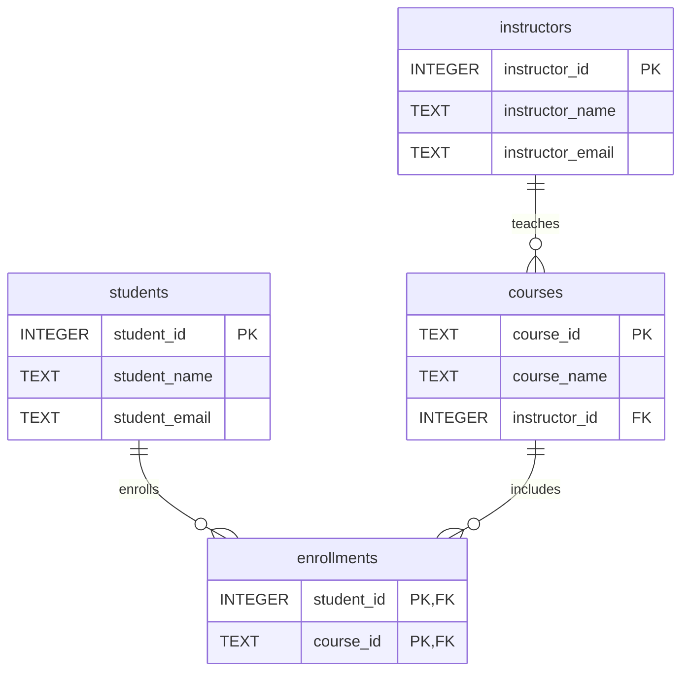

# Academic Schema Normalization

The original student_courses table mixes students, courses,
instructors, and enrollments. This repeats information and causes
update, insert, and delete anomalies.

The normalized design separates these concepts into four tables:

- students: stores each student's information once.
- instructors: stores each instructor's information once.
- courses: stores each course once and references its instructor.
- enrollments: connects students and courses using a composite primary key.

An instructor's email can now be updated in one row.
Courses can exist without enrollments.
Deleting an enrollment does not delete student, course, or instructor data.

The design follows Third Normal Form: each non-key attribute
depends on its table's key, without partial or transitive dependencies.

## ER Diagram

