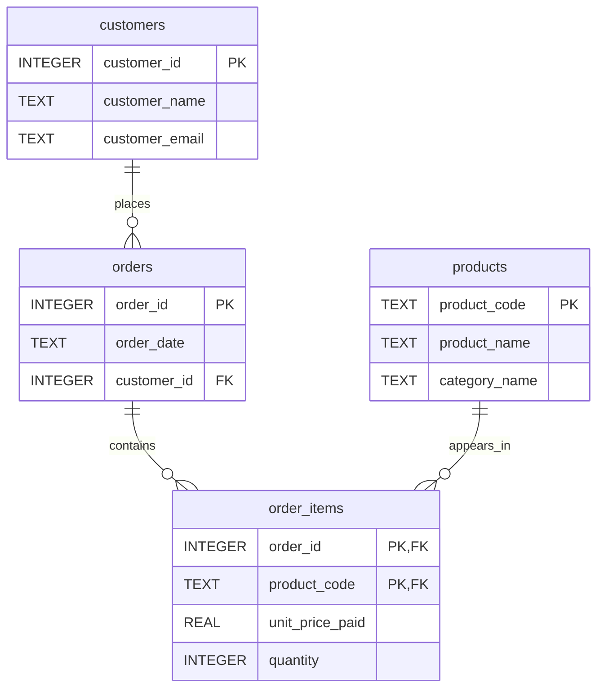

# Order System Redesign

The original table repeats customer, order, and product information
across order lines. This creates update, insert, and delete anomalies.

The new design separates four concepts:

- customers: stores customer information once.
- orders: stores the order date and references the customer.
- products: stores product descriptions once.
- order_items: connects orders and products and stores quantity
  and unit_price_paid.

unit_price_paid belongs in order_items because it records the actual
price paid for a product in a specific order. Keeping it there preserves
purchase history even when product prices change.

The composite primary key assumes each product appears once per order,
with quantity recording the number of units purchased.

Deleting an order item does not remove customer or product information.

## ER Diagram

