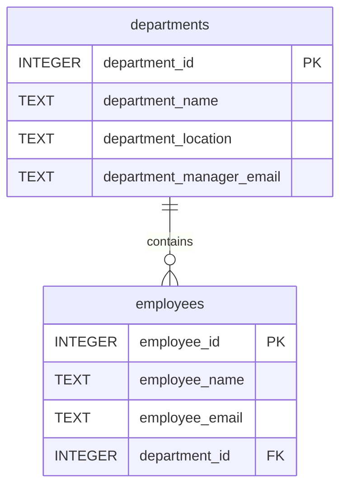

# Removing a Transitive Dependency

In the original table, employee_id determines department_id,
and department_id determines the department's name, location,
and manager email.

Department attributes therefore depend transitively on employee_id.
Repeating them for each employee creates update anomalies.

The new design stores department information once in departments.
The employees table references departments using a foreign key.

Changing a department's location now requires updating only one row.
A department can also exist without employees.

Removing only department_name would not solve the problem:
department_location and department_manager_email would still be
repeated across employee rows.

## ER Diagram

