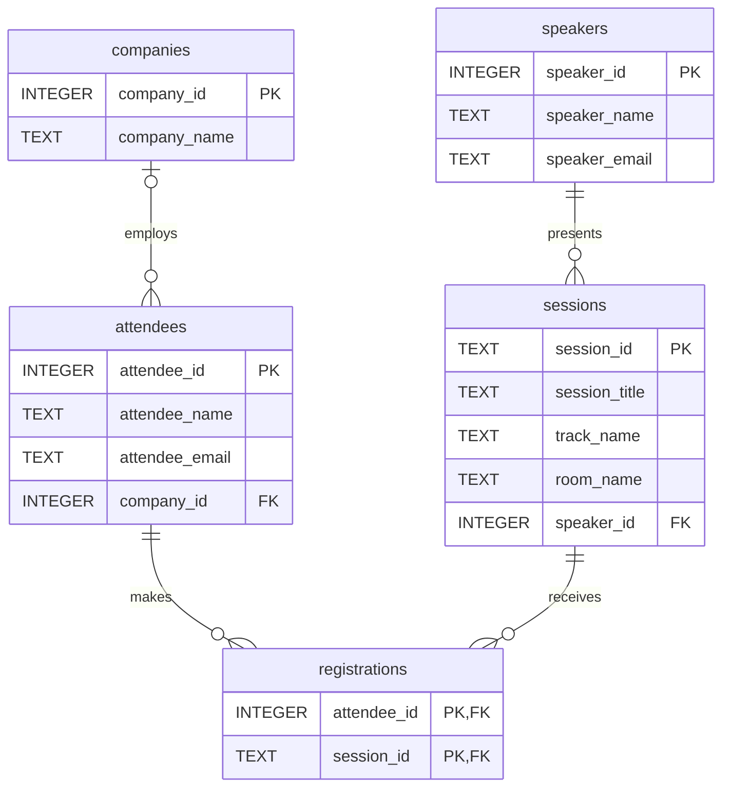

# Conference Registration Normalization

The original table repeats attendee, company, session, and speaker
information for each registration. This causes update, insert,
and delete anomalies.

The new design separates five concepts:

- companies: stores company names independently.
- attendees: stores each attendee once and optionally references a company.
- speakers: stores each speaker's name and email once.
- sessions: stores each session once and references its speaker.
- registrations: connects attendees and sessions.

A separate company table allows a company name to be updated in one
place. Keeping company names as plain text in attendees would be
simpler, but would repeat names and allow inconsistent spelling.

Track and room names remain session attributes because no additional
track or room details are required in this design.

Each session is assumed to have one speaker. An attendee can register
for multiple sessions, but only once per session.

Updating a speaker's email requires one change only.
Sessions can exist before anyone registers.
Deleting a registration does not delete session or speaker information.

## ER Diagram

